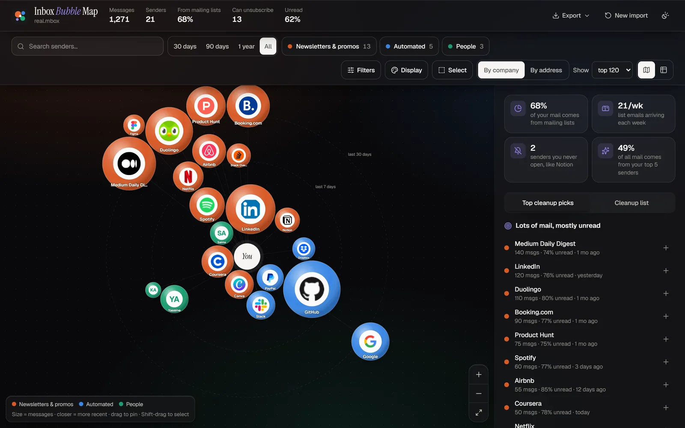
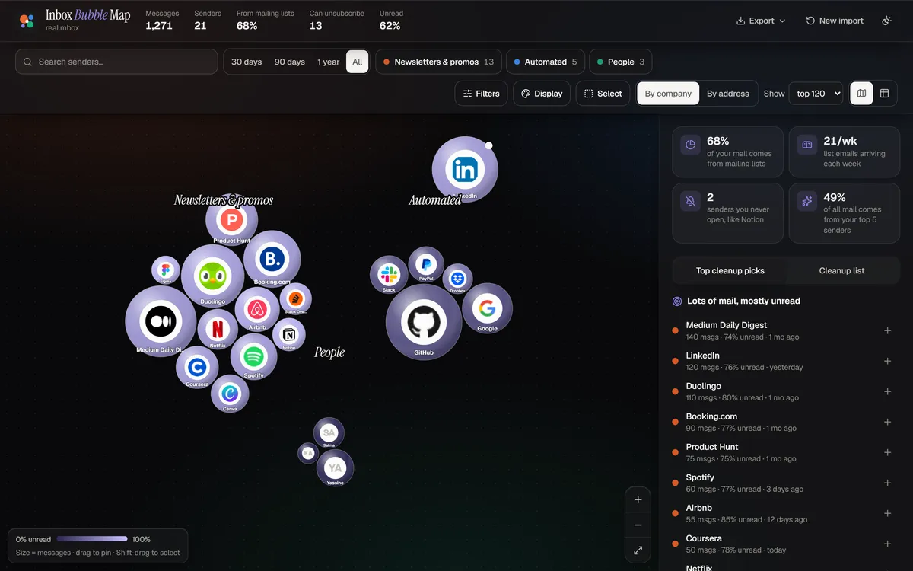
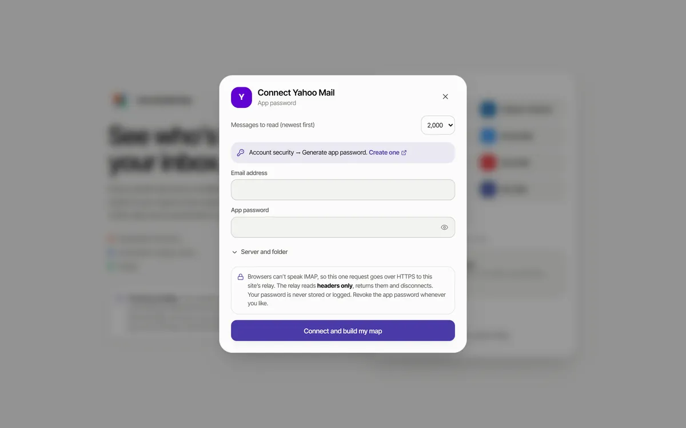

# Inbox Bubble Map

> See your email as a living map: you in the centre, every newsletter, service and person that writes to you as a floating bubble. Spot the lists you never open, unsubscribe, and pop them off the map.

[](https://github.com/Bosaj/inbox-bubble-map/actions/workflows/ci.yml)


**Live:** https://inbox-bubble-map.vercel.app · **Status:** v0.7 — read and clean your mail from the map (archive, trash, spam, mark read, one-click unsubscribe), in Arabic, French or English.
**Author:** Oussama EL HADJI. Part of the Bosaj ideas portfolio (sibling repo: `dual_portfolio_hub`).

<p align="center"></p>
<p align="center">
  
  &nbsp;
  
</p>

---

## Problem

People lose track of which newsletters and services email them. Bulk-unsubscribe tools show long lists. A living bubble map makes the mess visible at a glance, and popping a bubble when you unsubscribe makes cleaning up feel good.

## How to read the map

| Encoding | Meaning |
|---|---|
| **Bubble size** | number of messages from that sender (area ∝ count) |
| **Distance from "You"** | how long ago they last wrote (log scale; rings at 7 days, 30 days, 1 year) |
| **Colour** | 🟠 newsletters & promos (has `List-Unsubscribe` / `List-Id` / bulk) · 🔵 automated (no-reply, alerts, receipts) · 🟢 people |

Only three colours are used on purpose. In an all-pairs chart like this, three hues are the most that stay distinguishable for every reader, colour-blind included (validated with OKLab ΔE checks). The legend chips double as filters, every bubble has a label or tooltip, and a full **table view** is one click away.

## Connect any inbox

| Provider | How | What is read |
|---|---|---|
| **Gmail** | Google sign-in (`gmail.modify`) or an app password | map, read, archive, trash, spam, mark read, unsubscribe by email |
| **Outlook / Hotmail / Microsoft 365** | Microsoft sign-in (`Mail.ReadWrite`) | map, read, archive, trash, junk, mark read |
| **Yahoo, iCloud, AOL, GMX, Zoho, Fastmail, any IMAP** | app password through the relay | map, read, archive, trash, spam, mark read |
| **Any export** | drop a `.mbox` (Google Takeout, Thunderbird, Apple Mail) or `.eml` | map only (read-only) |
| **Demo** | fictional inbox | — |

Outlook.com switched off IMAP app passwords in September 2024, which is why Outlook uses Microsoft sign-in.

## Features

- **Premium look.** Geist and Instrument Serif type, an aurora background, glass panels, and glossy 3D bubbles with depth. Each company bubble carries its **logo** on a white plate; people get initials.
- **Logos without leaking who emails you.** Icons load through this site's `/api/logo` proxy (cached 30 days at the CDN, fixed icon sources only), so no icon service ever sees your sender list tied to your IP. Logos can be switched off in *Display*.
- **Colour classes.** Colour by type, unread rate (sequential), last seen (sequential) or "can unsubscribe", each with a matching legend.
- **Filters.** Only unsubscribable, minimum unread %, minimum messages, last wrote within, and Gmail tab, with an active-filter count and a reset.
- **Arrange it your way.** Drag a bubble and it stays where you drop it (double-click to release; *Unpin all* in *Display*). Layouts: **Orbit** (recency), **Clusters** (by type) or **Free**.
- **Select and move groups.** Shift/Ctrl-click, lasso (Shift-drag or the *Select* tool), or select all newsletters / automated / people / unsubscribable / never-opened. Dragging any selected bubble moves the whole group. The group bar can add the group to your cleanup list or pop them all.
- **Bubbles that move.** A live d3-force simulation with a gentle idle drift. Drag and fling any bubble and the others make room. Bubbles burst out of "You" on load and pop with particles when you clean a sender up (with undo). Motion pauses in background tabs and respects `prefers-reduced-motion`.
- **Time range.** 30 days, 90 days, 1 year or everything, measured from your newest message.
- **Insights.** Share of mail from lists, list emails per week, senders you never open, top-5 concentration, and how many emails a year your cleanup list will save you.
- **Sender detail.** Messages, unread %, last/first seen, a 12-month activity chart, recent subjects and addresses.
- **Read mail from the map.** The sender panel lists that sender's newest messages. Open one in a reader that blocks remote images and fonts (no tracking pixel ever fires), runs no scripts and opens links in a new tab.
- **Act on it.** Per message: mark read/unread, archive, trash, spam. Per sender or per selection: *Mark all read*, *Archive all*, *Move all to trash*, *Report spam*, with a confirmation that shows the count. Trash stays recoverable; nothing is ever permanently deleted. Emptied senders pop off the map.
- **Unsubscribe properly.** One-click RFC 8058 unsubscribe through `/api/unsubscribe` when the sender supports it; otherwise Gmail sends the `mailto:` unsubscribe email for you, or the sender's page opens. *Top cleanup picks* ranks by volume × unread × unsubscribable.
- **Arabic, French, English.** A language switcher on every screen, right-to-left layout and an Arabic typeface for Arabic, and local number and date formats.
- **Exports.** CSV, **Gmail filters** (`.xml`: skip inbox and mark read), **Sieve** rules (Fastmail, Proton, Posteo, cPanel…), and the **map as a PNG**.
- Search, grouping by company or address, zoom/pan, light/dark/system theme, responsive layout, strict CSP.

## Privacy

- The map is built from headers only: From, Date, Subject, List-Unsubscribe(-Post), List-Id, Precedence and read state. A message body is fetched only when you open that message, and your mailbox changes only after you confirm an action.
- Files, Google sign-in and Microsoft sign-in run **entirely in your browser**. Tokens stay in the tab's memory.
- Browsers can't open IMAP connections, so app-password providers go through `/api/imap`, a Vercel Function. Per request it connects over TLS, does one thing (read headers, list a sender, open one message, or apply one confirmed action), returns and disconnects. Your password stays in the tab and is sent with each request; the relay **never stores or logs** credentials or mail.
- **Relay hardening.** Port 993/TLS only; public hostnames only (DNS checked, private ranges refused, connection pinned to the checked address); same-origin requests only; 64 KB body limit; strict validation of sender lists and message ids; separate rate limits for full reads and for actions, plus a lockout after failed logins; `Cache-Control: no-store`. Trash and archive use the account's special-use folders (RFC 6154); nothing is expunged.
- **One-click unsubscribe relay** (`/api/unsubscribe`): POSTs only the standard `List-Unsubscribe=One-Click` body to an https URL from your own headers, on port 443, to a public address it checked and pinned. No cookies, no referrer, no redirects followed, 8-second timeout, rate-limited, nothing logged.
- **Reading mail.** HTML is shown in a sandboxed iframe (no scripts, no same-origin) with its own CSP (`default-src 'none'; img-src data: cid:`), so remote images, fonts and forms are blocked.
- No analytics, no cookies. Nothing is saved when you close the tab (only the theme choice).
- Unsubscribe links come from the emails and open only when you click them. Only `https:` and `mailto:` links are accepted.
- **Company logos** are requested from this site (`/api/logo?d=domain`), which fetches them from fixed icon services and caches them. Your browser never contacts an icon service, and the proxy never connects to the sender's own server, so it can't be used for SSRF. People and personal addresses never get logo requests.

## Architecture

```
api/imap.ts             IMAP relay (Vercel Function): headers / list / ids / body (postal-mime) / act; SSRF guard, rate limits, imapflow
api/unsubscribe.ts      RFC 8058 one-click unsubscribe relay (https only, pinned address, no redirects)
api/logo.ts             company icon proxy (fixed sources, type/size checks, 30-day CDN cache)
api/_lib/net.ts         shared hostname / private-address guards (not a route)
src/lib/display.ts      colour modes, filters, selection presets, logo domains, initials
src/lib/headers.ts      RFC 2047 decoding, From / List-Unsubscribe / Date parsing
src/lib/mbox.ts         streaming mbox reader (header blocks only, folding, CRLF)
src/lib/parse.worker.ts Web Worker: File.stream() → parser, progress events
src/lib/mailbox.ts      Mailbox interface, reader document (sandbox + CSP), demo mailbox, map updates after actions
src/lib/gmail.ts        Gmail API client (GIS token, paging, retry), read bodies, batchModify / trash / send
src/lib/outlook.ts      Microsoft Graph client (MSAL v5, silent refresh), read bodies, JSON $batch moves
src/lib/providers.ts    provider presets + IMAP relay client and mailbox
src/i18n.tsx            English, French and Arabic strings, plural rules, locale formats
src/lib/aggregate.ts    grouping, categories, months, insights, CSV / Gmail filters / Sieve
src/lib/layout.ts       scales + shared d3-force setup (static layout for tests and first frame)
src/components/         BubbleMap (physics, pins, lasso, group drag), MapControls, MailUI (messages, reader, bulk actions, unsubscribe), LangSwitch, ConnectDialog, Insights…
```

63 Vitest tests cover colour modes, filters, selection presets, the logo proxy, header decoding, chunk-independent mbox parsing, aggregation and insights, exports, the layout, the Gmail and Graph clients (paging, retries, body decoding, batchModify / trash / $batch moves, expired tokens), the IMAP relay (validation, SSRF, rate limits, origin check, special-use folders), the unsubscribe relay (URL checks, pinning, private targets, origin, rate limit), the reader CSP, the demo mailbox, translations (every key in all three languages) and the app flows (read a message, archive a sender, switch to Arabic). `GREENMAIL=1 npm test` also runs the relay's real imapflow code (list, open, mark read, move to Trash/Archive) against a local GreenMail IMAP server.

## Getting started

```bash
npm install
npm run dev        # http://localhost:5173 (the dev server also serves /api/imap)
npm test
npm run build
```

Optional sign-ins: copy `.env.example` to `.env` and set `VITE_GOOGLE_CLIENT_ID` and/or `VITE_MS_CLIENT_ID`. Every step is in that file. Without them, Gmail still works through an app password, and Outlook users are guided to an `.mbox` export.

## Roadmap

- [x] v0.1 — sender aggregation table, mbox import + Gmail metadata connect — [#1](https://github.com/Bosaj/inbox-bubble-map/issues/1)
- [x] v0.2 — force-directed bubble graph — [#2](https://github.com/Bosaj/inbox-bubble-map/issues/2)
- [x] v0.3 — unsubscribe links, Gmail search for bulk archive, cleanup list + CSV — [#3](https://github.com/Bosaj/inbox-bubble-map/issues/3)
- [x] v0.4 — live physics, any provider (IMAP relay + Outlook), insights, filter exports — [#4](https://github.com/Bosaj/inbox-bubble-map/issues/4), [#7](https://github.com/Bosaj/inbox-bubble-map/issues/7)–[#10](https://github.com/Bosaj/inbox-bubble-map/issues/10)
- [x] v0.6 — premium design with company logos, colour classes and filters, free placement and group selection — [#12](https://github.com/Bosaj/inbox-bubble-map/issues/12)–[#14](https://github.com/Bosaj/inbox-bubble-map/issues/14)
- [x] v0.7 — read and act on mail (archive, trash, spam, mark read, bulk clean), one-click unsubscribe, Arabic and French, Google sign-in on — [#5](https://github.com/Bosaj/inbox-bubble-map/issues/5), [#17](https://github.com/Bosaj/inbox-bubble-map/issues/17)–[#20](https://github.com/Bosaj/inbox-bubble-map/issues/20)
- [ ] Next — Microsoft sign-in client ID; Google verification for public (non-test) Gmail users

---

## For LLM agents & contributors continuing this project

- Keep the client-side paths client-side. The relays must stay stateless: no storage, no logs of credentials, URLs or mail.
- Scopes are `gmail.modify` and `Mail.ReadWrite` because the app archives, trashes and marks mail. Fetch a body only when the user opens that message, change mail only after a confirmation, and never delete permanently.
- Every user-facing string lives in `src/i18n.tsx` in all three languages; the translation test fails if a key is missing.
- Don't add categorical colours to the map: three categories are the validated maximum for this chart form. Sequential modes use a single hue, light to dark.
- Parser or relay changes need tests (`src/lib/lib.test.ts`, `src/lib/v04.test.ts`).

**Ground rules:** keep this README in sync with reality; write tests for anything correctness-critical; never commit secrets; follow Conventional Commits (see `CONTRIBUTING.md`).

## License

[MIT](LICENSE) — © 2026 Oussama EL HADJI
