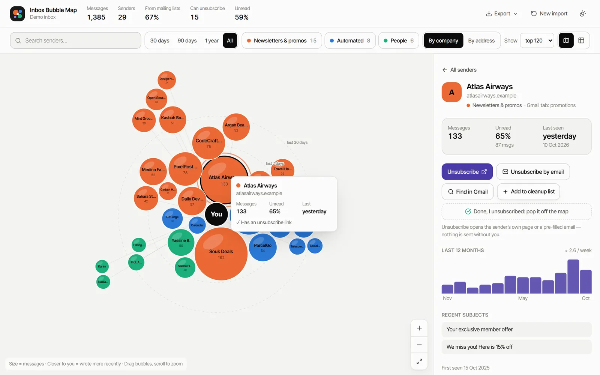
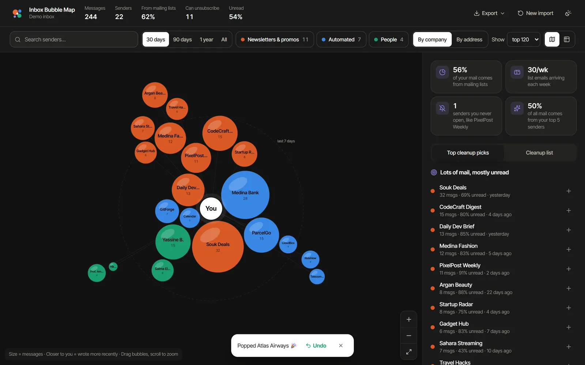
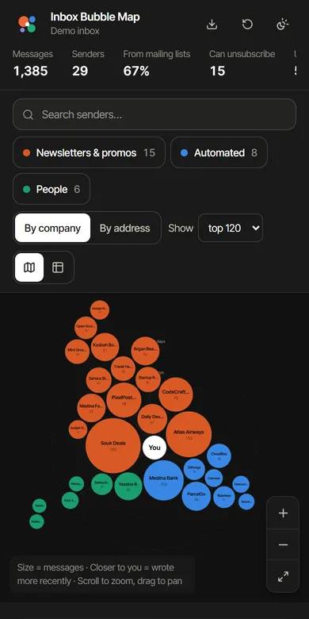

# Inbox Bubble Map

> See your email as a graph: you in the centre, every newsletter, service and person that writes to you as a bubble. Spot the lists you never open, and unsubscribe in a click. Everything runs in your browser.

[](https://github.com/Bosaj/inbox-bubble-map/actions/workflows/ci.yml)


**Live:** https://inbox-bubble-map.vercel.app · **Status:** v0.3 — bubble map, sender table, unsubscribe links and cleanup list shipped; generic IMAP is next.
**Author:** Oussama EL HADJI. Part of the Bosaj ideas portfolio (sibling repo: `dual_portfolio_hub`).

<p align="center"></p>
<p align="center">
  
  &nbsp;
  
</p>

---

## Problem

People lose track of which newsletters and services email them. Bulk-unsubscribe tools exist, but they show long lists. A bubble map makes the mess visible at a glance: the biggest, most-ignored senders jump out.

## How to read the map

| Encoding | Meaning |
|---|---|
| **Bubble size** | number of messages from that sender (area ∝ count) |
| **Distance from "You"** | how long ago they last wrote (log scale; rings at 7 days, 30 days, 1 year) |
| **Colour** | 🟠 newsletters & promos (has `List-Unsubscribe` / `List-Id` / bulk) · 🔵 automated (no-reply, alerts, receipts) · 🟢 people |

Only three colours are used on purpose: in an all-pairs chart like this, three hues are the most that stay distinguishable for every reader, colour-blind included (validated with OKLab ΔE checks). The legend chips double as filters, every bubble has a label or tooltip, and a full **table view** is one click away.

## Features

- **Import without giving anything away.** Drop a Google Takeout `.mbox` (or `.eml` files). It is streamed in a Web Worker in constant memory, so multi-GB exports work. Only headers are read.
- **Optional Gmail connect.** Uses the `gmail.metadata` scope (headers and labels only, never bodies). The token stays in memory. Turn it on by setting `VITE_GOOGLE_CLIENT_ID`.
- **Demo inbox** with fictional senders, so you can try it in one click.
- **Bubble map.** Zoom, pan, search highlighting, top-N cap, and grouping *by company* (subdomains merged) or *by address*.
- **Sender details.** Messages, unread %, first/last seen, Gmail tab, recent subjects and all addresses.
- **Cleanup actions.** *Unsubscribe* opens the sender's `List-Unsubscribe` page or a pre-filled email. *Find in Gmail* opens a `from:` search so you can archive in bulk. *Top cleanup picks* ranks senders by volume × unread × unsubscribable.
- **Cleanup list and CSV export**, so you can work through your unsubscribes or keep a record.
- Light/dark/system theme, responsive layout, reduced-motion aware, strict CSP on Vercel.

## Privacy

- No backend, analytics or cookies. The app is static files.
- The `.mbox` is parsed locally; message bodies are skipped, never stored.
- Nothing is persisted: close the tab and the analysis is gone. Only the theme choice goes to `localStorage`.
- Unsubscribe links come from the emails themselves and are only opened when you click them. Only `https:` and `mailto:` links are accepted.

## Architecture

```
src/lib/headers.ts      RFC 2047 decoding, From / List-Unsubscribe / Date parsing
src/lib/mbox.ts         streaming mbox reader (header blocks only, folding, CRLF)
src/lib/parse.worker.ts Web Worker: File.stream() → parser, progress events
src/lib/gmail.ts        optional Gmail API client (GIS token, paging, retry, concurrency)
src/lib/aggregate.ts    group by company/address, categorise, cleanup score, CSV
src/lib/layout.ts       deterministic d3-force layout (radial recency + collision)
src/lib/demo.ts         fictional demo inbox
src/components/         React UI (map, side panel, table, import screen)
```

19 Vitest tests cover header decoding, chunk-independent mbox parsing, aggregation, the layout (no overlaps), the Gmail client (paging, 429 retry) and the main UI flows.

## Getting started

```bash
npm install
npm run dev        # http://localhost:5173
npm test
npm run build
```

Optional Gmail connect: copy `.env.example` to `.env`, create a Google OAuth **Web** client, add your origins and set `VITE_GOOGLE_CLIENT_ID`. Unverified Google apps are limited to test users you add in the consent screen.

## Roadmap

- [x] v0.1 — sender aggregation table, mbox import + Gmail metadata connect — [#1](https://github.com/Bosaj/inbox-bubble-map/issues/1)
- [x] v0.2 — force-directed bubble graph — [#2](https://github.com/Bosaj/inbox-bubble-map/issues/2)
- [x] v0.3 — unsubscribe links, Gmail search for bulk archive, cleanup list + CSV — [#3](https://github.com/Bosaj/inbox-bubble-map/issues/3)
- [ ] v0.4 — other providers (generic IMAP) — [#4](https://github.com/Bosaj/inbox-bubble-map/issues/4). Browsers can't speak IMAP, so this needs a small local bridge or desktop wrapper.

---

## For LLM agents & contributors continuing this project

- Keep it client-side. If a backend is ever added for IMAP, keep credentials on the user's machine and never log them.
- Request the narrowest Gmail scope that works (`gmail.metadata`). Never fetch or store bodies.
- Don't add colours to the map: three categories are the validated maximum for this chart form. Use filters, labels or the table instead.
- Parser changes need tests in `src/lib/lib.test.ts`, including the chunking test.

**Ground rules:** keep this README in sync with reality; write tests for anything correctness-critical; never commit secrets; follow Conventional Commits (see `CONTRIBUTING.md`).

## License

[MIT](LICENSE) — © 2026 Oussama EL HADJI
